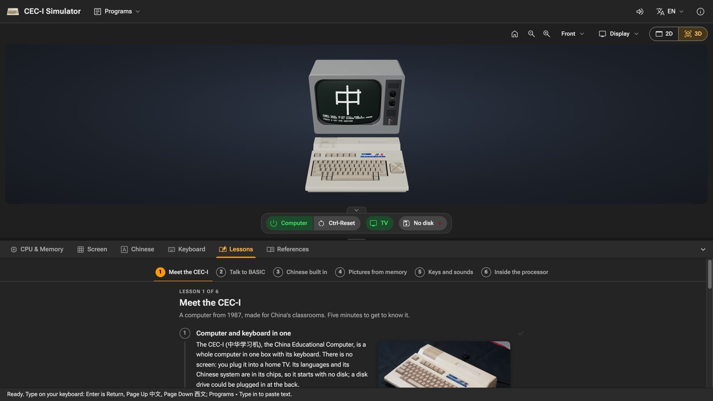
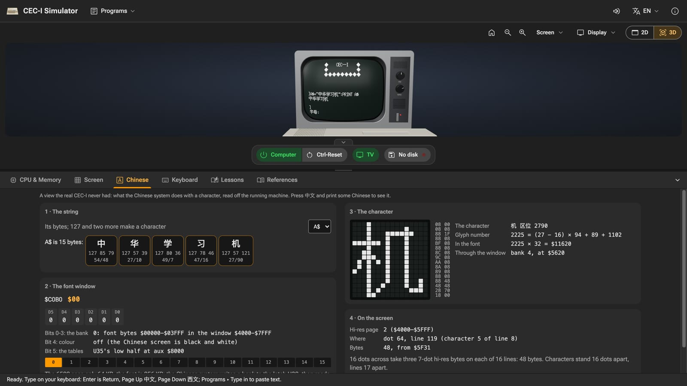
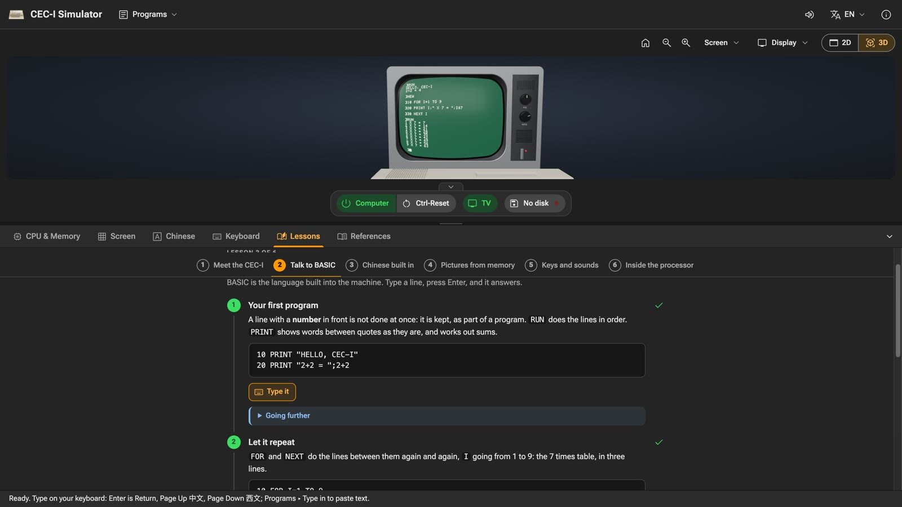
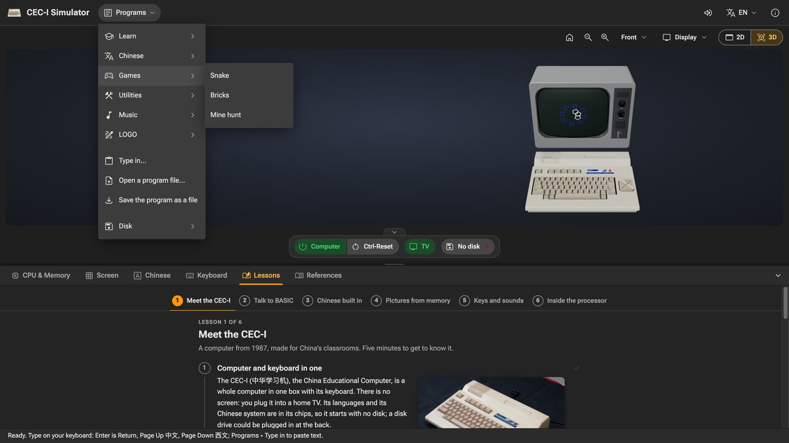
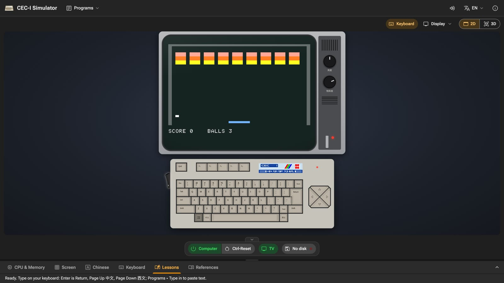
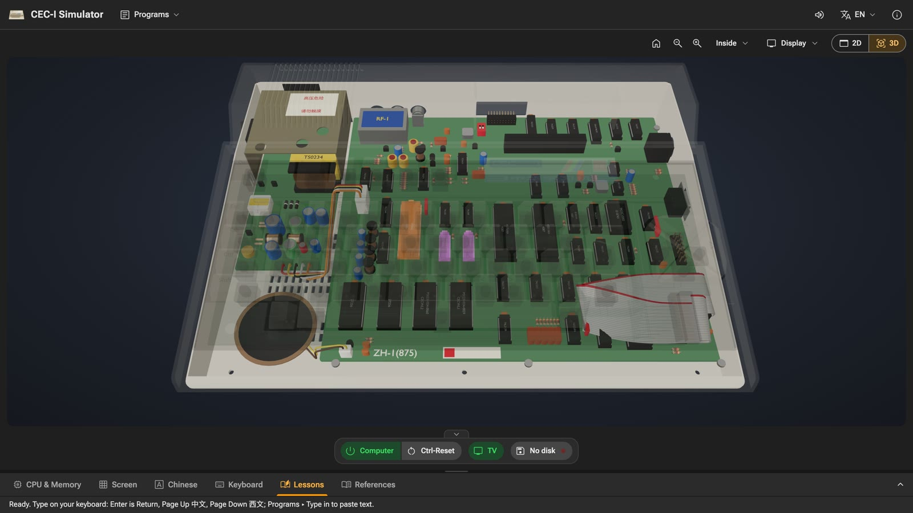
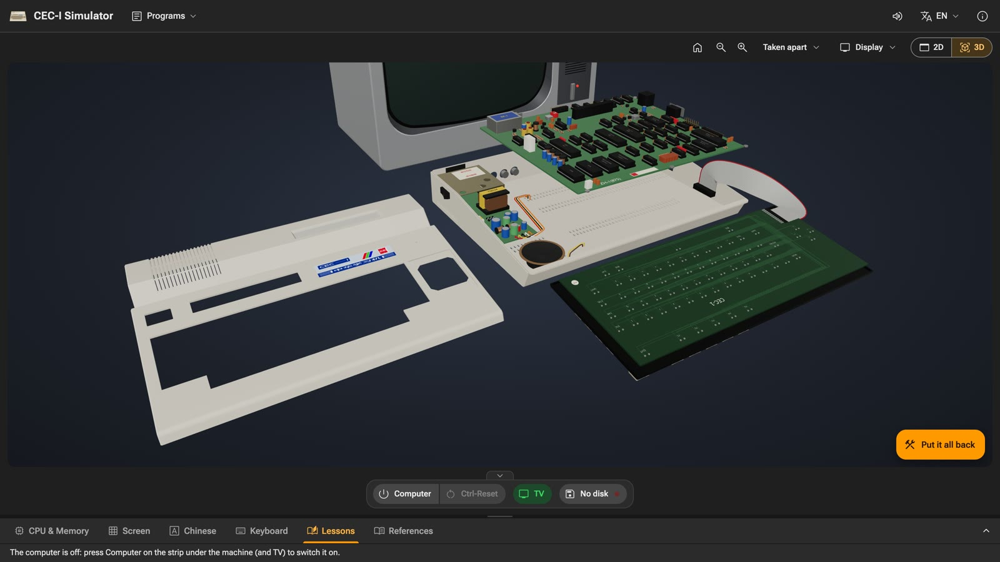
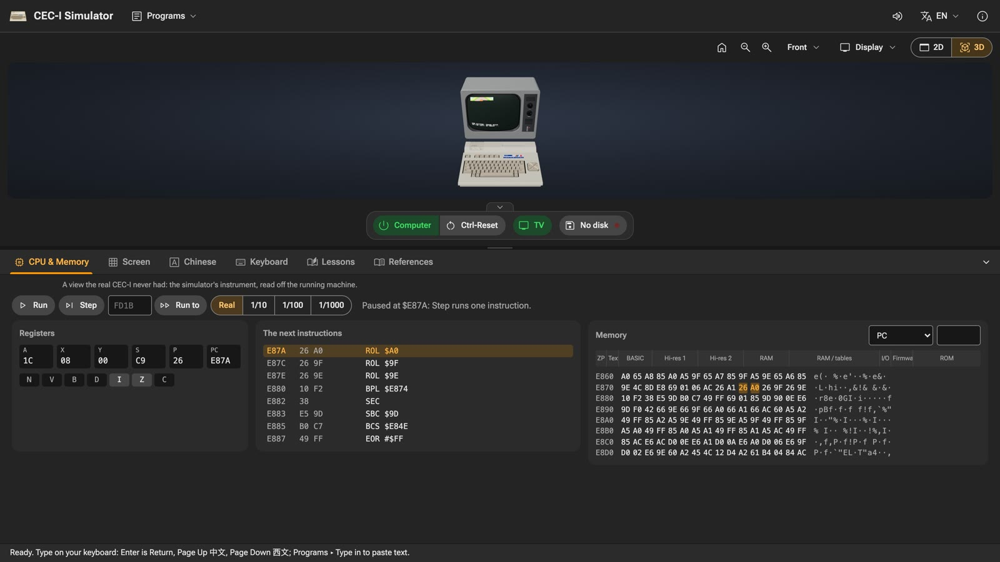

<p align="center"></p>

# CEC-I Simulator · 中华学习机模拟器

[](https://github.com/wixette/cec-i-simulator/actions/workflows/test.yml)

**The CEC-I 中华学习机 (China Educational Computer) of 1987, in 3D, in your browser.** It beeps as it switches on, says `ZHONG HUA XUE XI JI`, and waits at BASIC's prompt. Write a few lines of BASIC, press 中文 and type Chinese, play a game of Snake; or open it up to see how an 8-bit computer shows thousands of Chinese characters.

**[▶ Try it online](https://wixette.github.io/cec-i-simulator/)**: nothing to install, on a computer or a phone, in ten languages. ([中文说明](README.md))



## What was the CEC-I?

In 1984 Deng Xiaoping said that the popularisation of computers should start with children. In answer, a design group led by Tsinghua University made the **CEC-I**, the China Educational Computer, launched in 1987: an Apple IIe compatible built into one box with its keyboard, using a home TV as its screen, and a disk drive or a cassette recorder to keep programs if one was plugged in, for about 960 yuan. In school computer rooms across China, students wrote their first programs on it.

Its own idea is Chinese. A computer of the time knew 96 letters and signs; the CEC-I carries the whole national character set, GB 2312's 7,445 characters, as 16 × 16 dots in two font chips on its main board, and a Chinese system that starts at the press of a key, with no disk.

## Your first minutes

1. **Open the simulator.** The computer and the TV are on: `ZHONG HUA XUE XI JI`, `VERSION 1.1`, then BASIC's prompt `]`.
2. **Type** `PRINT "HELLO"` and press Enter.
3. **Press 中文** (Page Up on your keyboard, or Alt-Z): the Chinese system starts. 西文 (Page Down, or Alt-X) goes back.
4. **Play:** Programs ▸ Games ▸ Snake, then **Type it in**. The simulator types the listing on the machine's keys, as an owner typed one from a magazine; then steer with the arrows.
5. **Learn:** the Lessons tab under the machine has six short lessons, from switching on to the processor's own steps. Every step has **Type it**.
6. **Open it up:** switch it off, and choose Taken apart from the 3D views.

**Your keyboard is the CEC-I's.** Letters, digits and signs where they are; its own keys:

| The CEC-I | Your keyboard | Or |
|---|---|---|
| 中文 | Page Up | Alt-Z |
| 西文 | Page Down | Alt-X |
| F1–F5 | F1–F5 | Alt-1 … Alt-5 |
| Quit | F6 | Alt-Q |
| Test | End | Alt-T |
| Reset | F12 | Alt-R |
| ◁ | Backspace | ← |

Ctrl-Reset is Ctrl-F12. On a phone, switch to 2D and type on the drawn keyboard.

## What you can do

<table>
<tr>
<td colspan="2"><b>Chinese, built in</b><br>Press 中文 and type Chinese by its 区位 (quwei) code or by pinyin. The Chinese instrument below reads the running machine: a character's bytes, its dots in the font chips, and how they reach the screen.<br></td>
</tr>
<tr>
<td width="50%"><b>Follow the lessons</b><br>Six short ones, each a class period.<br></td>
<td width="50%"><b>Run our programs</b><br>Sixteen of our own: games, Chinese, music, LOGO and more.<br></td>
</tr>
<tr>
<td><b>Switch to 2D</b><br>The TV's picture large and sharp, the keyboard drawn out like a drawer. On a phone, this is where you type.<br></td>
<td><b>Look inside while it runs</b><br>The case turns to glass; the board's chips light up as they work.<br></td>
</tr>
<tr>
<td><b>Take it apart</b><br>With the power off, in the order the real one comes apart.<br></td>
<td><b>Watch the CPU work</b><br>Registers, the next instructions and memory, a step at a time.<br></td>
</tr>
</table>

### Programs

Open **Programs** in the top bar. Each program opens a page that says what it does and shows its listing; **Type it in** types it on the machine's keys and runs it.

- **Learn:** Guess my number, Bar chart, Hi-res curves, Big character, BASIC against machine code.
- **Chinese:** Idiom quiz, Reading numbers.
- **Games:** Snake, Bricks, Mine hunt.
- **Utilities:** Calendar, Clock, Text editor.
- **Music:** Music box, Organ.
- **LOGO:** Kaleidoscope.

**Programs ▸ Type in…** takes a BASIC program of your own, pasted, and types it in, its Chinese through the machine's own 区位 input. **Save the program as a file** saves a BASIC program as text, its Chinese as Chinese; while LOGO runs, it saves LOGO's procedures.

### The lessons

1. **Meet the CEC-I:** the computer, its keyboard and its TV; switching on; the inside.
2. **Talk to BASIC:** a first program, a loop, a question and a choice, and a whole game: Guess my number.
3. **Chinese built in:** the Chinese system started; a character is three bytes; its dots fetched from the font chips.
4. **Pictures from memory:** a letter put on the screen with `POKE`; coloured blocks and lines; a bar chart; LOGO's turtle.
5. **Keys and sounds:** the keyboard's matrix; a note, then a scale, with `MUSIC`; the organ.
6. **Inside the processor:** the clock paused; instructions in slow motion, one at a time; BASIC against machine code.

A step is ticked when the machine shows it done.

### Disks

**Programs ▸ Disk** inserts a `.dsk`, `.do`, `.po`, `.nib` or `.woz` disk image (or drop the file on the page), and the machine starts from it as it did: DOS 3.3 and the games on its disks. What is written to the disk can be saved as a file again. Bring your own disks: none are hosted here.

### In ten languages

简体中文, 繁體中文, English, 日本語, 한국어, Español, Français, Deutsch, Italiano and Português (Brasil), the lessons included: choose one with the language button in the top bar. The machine's own words (BASIC, the Chinese system) stay as the machine has them.

## Is it the real machine?

This simulator is that machine, part for part:

| | The CEC-I | The simulator |
|---|---|---|
| Processor | 6502 at about 1.02 MHz | the same, every instruction's cycles exact; passes all 1.51 million SingleStepTests cases |
| ROM | the system ROM (monitor, CEC-BASIC, LOGO), the Chinese system, two font chips, the character generator, the keyboard ROM | the full set of a working machine ([roms/NOTICE](roms/NOTICE)) |
| RAM | 64 KB (48 KB and the language card's 16 KB), no auxiliary RAM | the same |
| Chinese | all 7,445 characters of GB 2312; pinyin and 区位 (quwei) input | the same, its own Chinese system running |
| Display | a TV or a monitor: 40 × 24 text, lo-res and hi-res colour graphics | a colour TV of the 1980s; or a black-and-white TV, or a green monitor; the case new, or yellowed as it is found today |
| Sound | a speaker, the `MUSIC` command | the same |
| Storage | a 5.25-inch disk drive (Disk II compatible, slot 6), or a cassette recorder | the disk drive; no recorder |
| Not here | the printer | |

The machine's four books are transcribed (in Chinese) in the [cec-i-docs](https://github.com/wixette/cec-i-docs) project.

---

## For developers

Everything below is for people who want to run, change or check the simulator itself.

### Run it locally

There is nothing to build. Serve the folder over HTTP:

```
git clone https://github.com/wixette/cec-i-simulator.git
cd cec-i-simulator
python3 -m http.server 8000
```

Then open <http://localhost:8000/>.

### Check it

With Node.js and pnpm:

```
pnpm install
pnpm check            # the unit tests, the strict type check and the reference check (what CI runs)
pnpm test:browser     # the page itself in a headless Chrome; run locally, in full before a release
pnpm test:6502        # all 1.51 million SingleStepTests cases (downloads about 750 MB the first time)
```

The unit tests run the CEC-I's real ROMs on the emulated 6502: every lesson end to end, and every one of our programs typed in and run.

### Tools

- `pnpm shots`: screenshots for the README and for posts, in any of the ten languages; `pnpm shots --readme` updates `screenshots/`.
- `pnpm video`: short clips for posts, with their sound (the power-on beep, `MUSIC`, the games) recorded as the page makes it.
- `pnpm build:model`: rebuilds the 3D model from its measured parameters with Blender's scripts.

### Documents

- how the simulator is checked, built and released: [docs/development.md](docs/development.md);
- what 1.0 promises to keep (links, file formats): [docs/stability.md](docs/stability.md);
- the rules the code follows: [docs/conventions.md](docs/conventions.md); the page's design: [docs/ui-design.md](docs/ui-design.md);
- the machine's decisions: [design/decisions.md](design/decisions.md), and the plan: [design/roadmap.md](design/roadmap.md);
- the 3D model: [model/README.md](model/README.md); how the machine works and what was measured: [research/README.md](research/README.md);
- how to contribute: [CONTRIBUTING.md](CONTRIBUTING.md); what the page keeps in your browser: [docs/privacy.md](docs/privacy.md).

### How it is made

- **The machine:** a cycle-exact 6502 with the CEC-I's ROMs, 64 KB of RAM, the text and graphics displays, the font chips, the keyboard, the speaker and the disk drive (`js/sim/`).
- **The 3D model:** built from measured parameters and the boards' netlists by Blender scripts, in `model/`, drawn with three.js (`js/scene/`).
- **The page:** plain JavaScript modules, no framework and no build step, type-checked with TypeScript's checker (`js/app/`, `js/ui/`).

## Licences

- The code is under the [Apache License 2.0](LICENSE).
- The 3D model, the docs, the photographs and the research notes are under [CC BY-SA 4.0](LICENSES/CC-BY-SA-4.0.txt).
- The ROMs in `roms/` are not ours: their copyright is the machine's makers'. They are carried as historical artifacts; [roms/NOTICE](roms/NOTICE) says where they came from, and offers to remove them on request.
- Third-party material keeps its own licence: three.js (MIT), the fonts (OFL 1.1), the icons (Apache-2.0). See [docs/licensing.md](docs/licensing.md) and `REUSE.toml`.

"CEC-I" and 中华学习机 name the machine simulated. This project is not affiliated with its designers or makers.

## Credits

- [cec-i-docs](https://github.com/wixette/cec-i-docs): the CEC-I's four books, transcribed, the simulator's main source.
- MAME's CEC-I driver and ROM set, checked against.
- Tom Harte's [SingleStepTests](https://github.com/SingleStepTests/65x02), for the 6502.
- [three.js](https://threejs.org/), and the Noto Sans SC and Noto Serif SC fonts.
- The page follows the author's [TRS-80 Simulator](https://github.com/wixette/trs-80-simulator).
