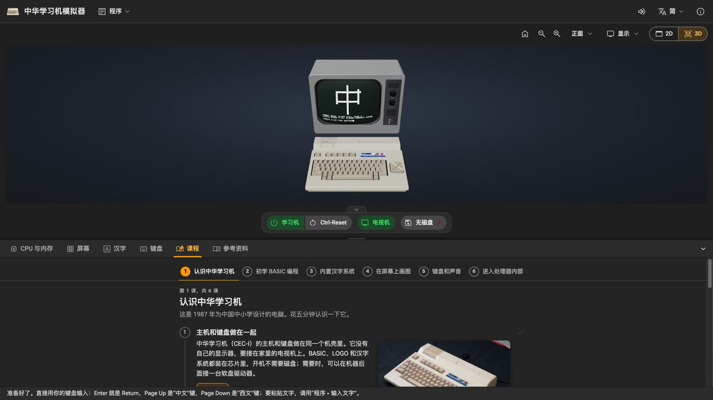
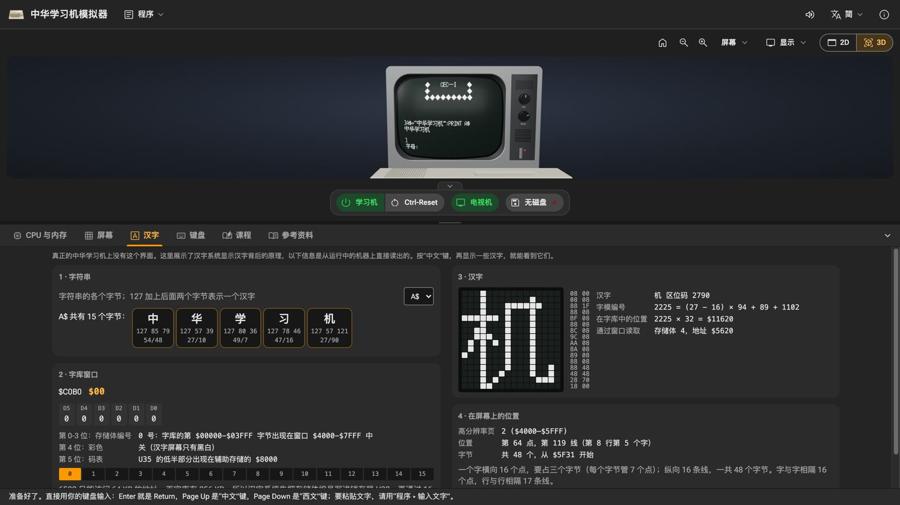
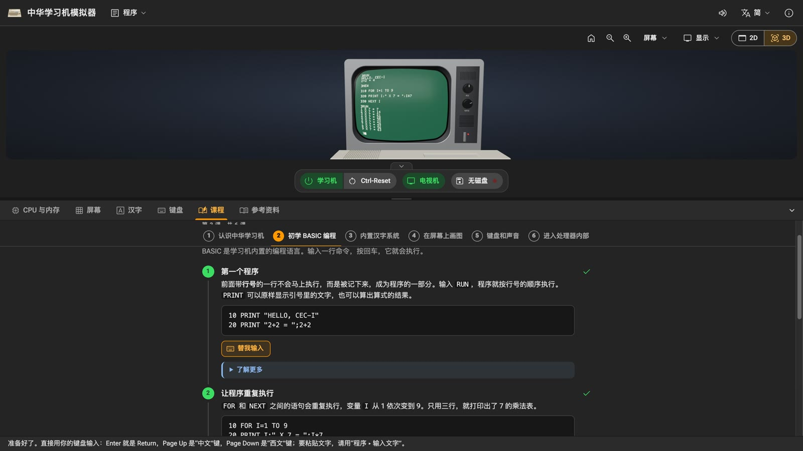
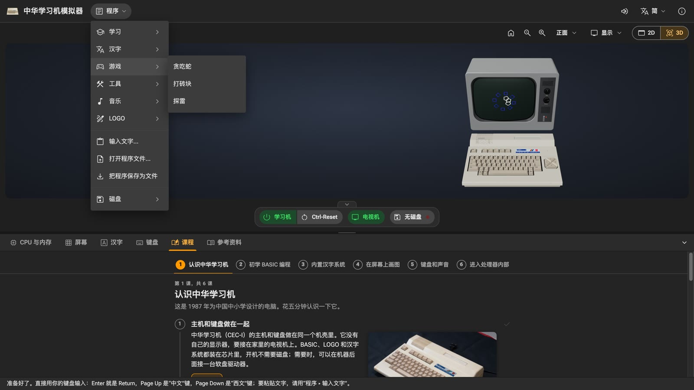
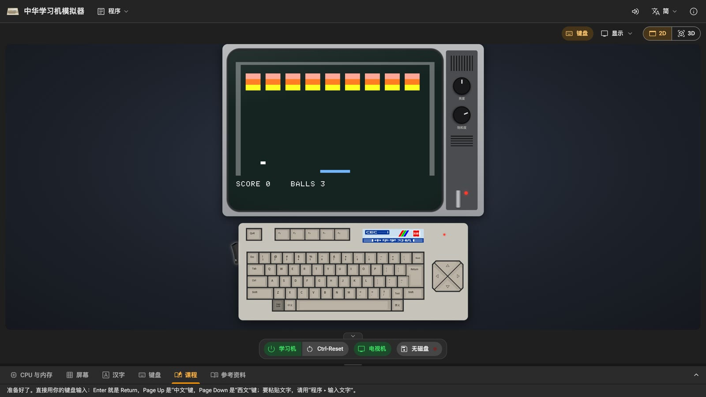
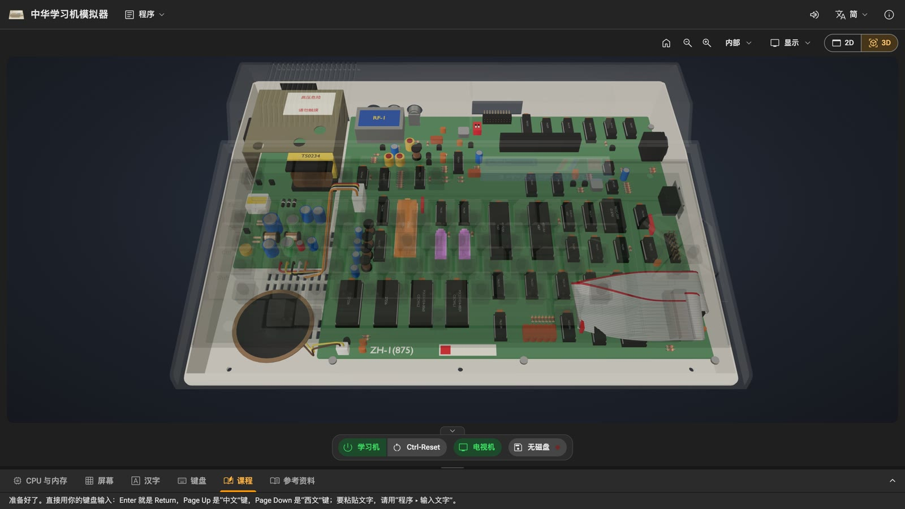
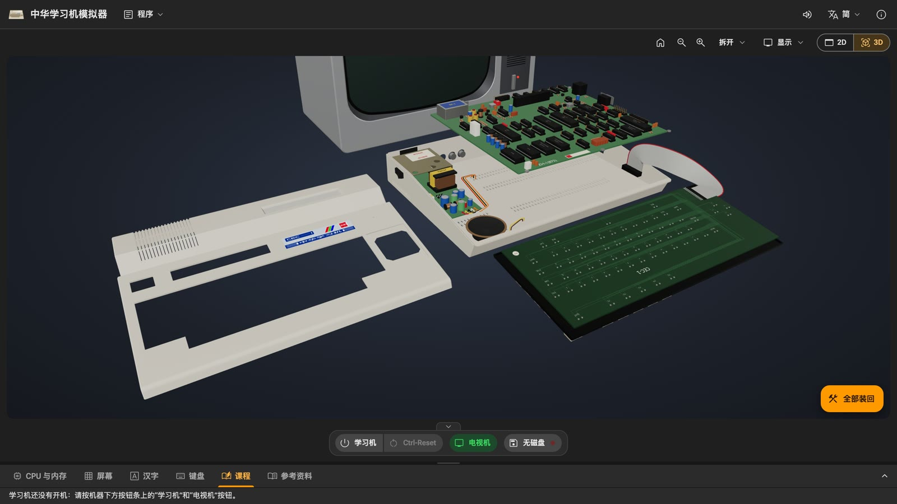
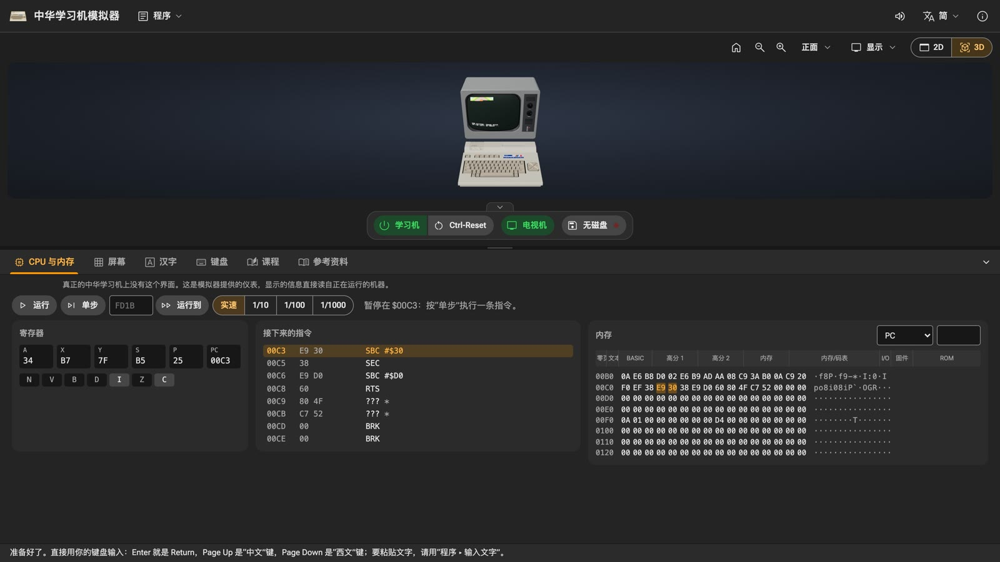

<p align="center"></p>

# 中华学习机模拟器 · CEC-I Simulator

[](https://github.com/wixette/cec-i-simulator/actions/workflows/test.yml)

**还记得当年计算机教室里的中华学习机吗？打开浏览器，就能再用上它。** 开机“嘀”的一声，屏幕上出现 `ZHONG HUA XUE XI JI`，接着是 BASIC 的提示符。你可以编几行 BASIC 程序，按“中文”键输入汉字，玩一局贪吃蛇；也可以打开机壳，看看一台 8 位电脑是怎样显示成千上万个汉字的。

**[▶ 在线试用](https://wixette.github.io/cec-i-simulator/)**：无需安装，电脑、手机均可使用。界面支持简体中文、繁體中文、English、日本語、한국어、Español、Français、Deutsch、Italiano、Português 十种语言。

> **English:** The CEC-I 中华学习机 (China Educational Computer, 1987) was China's school computer: an Apple IIe compatible with the whole GB 2312 Chinese character set in two font chips on its main board. This simulator runs its own ROMs in your browser, in 3D, with its TV and its keyboard. **[Read the English README](README.en.md).**



## 中华学习机简介

1984 年，邓小平提出“计算机的普及要从娃娃做起”。清华大学牵头的联合设计组为此研制了 **CEC-I 中华学习机**，1987 年推出。它与 Apple IIe 兼容，主机和键盘做在一个机壳里，接上家里的电视机就能用，要保存程序时再接软盘驱动器或录音机，售价约 960 元。全国许多中小学的计算机教室里摆的就是它，不少人的第一个程序就是在它上面写的。

它最大的特色是汉字处理。同时代的电脑大多只能显示 96 个英文字母和符号，中华学习机却把国家标准 GB 2312 中的 7445 个汉字和符号，以 16 × 16 点阵存在主板上的两片字库芯片里。按一下“中文”键即可进入汉字系统，无需软盘。

## 快速上手

1. **打开模拟器：** 学习机和电视机已经开机，屏幕上依次出现 `ZHONG HUA XUE XI JI`、`VERSION 1.1`，然后是 BASIC 的提示符 `]`。
2. **试一条命令：** 输入 `PRINT "HELLO"`，按回车，屏幕上就会显示 HELLO。
3. **进入汉字系统：** 按“中文”键（电脑键盘上的 Page Up，或 Alt-Z）；按“西文”键（Page Down，或 Alt-X）返回西文状态。
4. **玩游戏：** 选择“程序 ▸ 游戏 ▸ 贪吃蛇”，点“输入并运行”。模拟器会像当年照着书刊上的程序清单录入那样，逐键替你输入，程序运行后用方向键控制蛇。
5. **上课：** 机器下方的“课程”标签页里有六节课，从开机讲起，一直讲到处理器内部；每一步都可以点“替我输入”。
6. **拆机：** 先关机，再在 3D 视角菜单中选择“拆开”。

**电脑键盘就是学习机键盘。** 字母、数字和符号键位置相同，学习机特有的按键对应如下：

| 学习机按键 | 电脑键盘 | 或者 |
|---|---|---|
| 中文 | Page Up | Alt-Z |
| 西文 | Page Down | Alt-X |
| F1–F5 | F1–F5 | Alt-1 … Alt-5 |
| Quit | F6 | Alt-Q |
| Test | End | Alt-T |
| Reset | F12 | Alt-R |
| ◁ | Backspace | ← |

Ctrl-Reset 对应 Ctrl-F12。在手机上，请切换到 2D 视图，使用屏幕上的键盘输入。

## 功能一览

<table>
<tr>
<td colspan="2"><b>内置汉字系统</b><br>按“中文”键，用区位码或拼音输入汉字。下方的“汉字”仪表实时读取运行中的机器：每个汉字的内码字节、字库中的点阵，以及字形如何逐行显示到屏幕上。<br></td>
</tr>
<tr>
<td width="50%"><b>课程学习</b><br>六节课，每节正好一堂信息技术课的时间。<br></td>
<td width="50%"><b>示例程序</b><br>本项目编写的十六个程序：游戏、汉字、音乐、LOGO 等。<br></td>
</tr>
<tr>
<td><b>2D 平面视图</b><br>电视画面大而清晰，键盘可以像抽屉一样拉出。在手机上就用这个视图输入。<br></td>
<td><b>透视内部</b><br>机壳变为透明，主板上的芯片随工作状态亮起。<br></td>
</tr>
<tr>
<td><b>拆机</b><br>关机后，按真机的结构逐层拆开。<br></td>
<td><b>观察 CPU 运行</b><br>寄存器、即将执行的指令和内存一目了然，还可以单步执行。<br></td>
</tr>
</table>

### 示例程序

点击顶栏的“程序”菜单。每个程序都附有说明和完整的程序清单，点“输入并运行”，模拟器就会逐键替你输入并运行。

- **学习：** 猜数、柱状图、高分辨率曲线、放大汉字、BASIC 与机器码
- **汉字：** 成语填空、数字读法
- **游戏：** 贪吃蛇、打砖块、探雷
- **工具：** 万年历、时钟、文本编辑器
- **音乐：** 音乐盒、电子琴
- **LOGO：** 万花筒

用“程序 ▸ 输入文字…”可以粘贴你自己的 BASIC 程序，其中的汉字也会通过学习机自带的区位码输入法录入。用“把程序保存为文件”可以把 BASIC 程序存为文本文件，汉字照样保留；在 LOGO 中则保存 LOGO 过程。

### 课程内容

1. **认识中华学习机**：主机、键盘和电视机，开机，打开机壳
2. **初学 BASIC 编程**：第一个程序、循环、提问和判断，最后写一个完整的猜数游戏
3. **内置汉字系统**：启动汉字系统，一个汉字占三个字节，从字库芯片中取出字形
4. **在屏幕上画图**：用 `POKE` 显示字母，彩色方块和线条，柱状图，LOGO 的小海龟
5. **键盘和声音**：键盘矩阵，用 `MUSIC` 发音、演奏音阶，弹电子琴
6. **进入处理器内部**：暂停时钟，慢动作看指令一条条执行，BASIC 和机器码比速度

每完成一步，机器上真正出现了相应的结果，这一步就会自动打勾。

### 软盘

在“程序 ▸ 磁盘”中插入 `.dsk`、`.do`、`.po`、`.nib` 或 `.woz` 磁盘映像（也可以直接把文件拖到页面上），学习机就会像当年一样从软盘启动 DOS 3.3 和盘上的游戏。写入软盘的内容可以再另存为文件。磁盘软件需自行准备，本项目不提供。

### 多语言界面

简体中文、繁體中文、English、日本語、한국어、Español、Français、Deutsch、Italiano、Português (Brasil)，课程内容同样支持，可通过顶栏的语言按钮切换。学习机本身显示的文字（BASIC、汉字系统）保持原样。简体中文直接用中文撰写，并非从英文翻译。

## 与真机对照

本模拟器按照真机，逐个部件地再现了这台机器：

| | 中华学习机 | 模拟器 |
|---|---|---|
| 处理器 | 6502，约 1.02 MHz | 同样的 6502，每条指令的周期数都准确，通过了全部 151 万个 SingleStepTests 测试 |
| ROM | 系统 ROM（监控程序、CEC-BASIC、LOGO）、汉字系统 ROM、两片字库、字符发生器、键盘 ROM | 一台能正常工作的学习机上的全套 ROM（见 [roms/NOTICE](roms/NOTICE)） |
| 内存 | 64 KB（48 KB 主存加上语言卡的 16 KB），没有辅助内存 | 相同 |
| 汉字 | GB 2312 中的全部 7445 个汉字和符号；拼音和区位码输入 | 相同，运行的就是它自己的汉字系统 |
| 显示 | 接电视机或监视器：40 × 24 的文本，低分辨率和高分辨率彩色图形 | 一台八十年代的彩色电视机，也可以换成黑白电视机或绿色单色显示器；机壳可以是崭新的，也可以是如今泛黄的样子 |
| 声音 | 内置喇叭，`MUSIC` 语句 | 相同 |
| 外存储器 | 5.25 英寸软盘驱动器（与 Disk II 兼容，接在 6 号槽口），或者录音机 | 软盘驱动器；没有录音机 |
| 没有模拟 | 打印机 | |

学习机的四本原始手册已经整理成数字版，见 [cec-i-docs](https://github.com/wixette/cec-i-docs) 项目。

---

## 开发者指南

以下内容面向需要在本地运行、修改或测试模拟器的开发者。

### 本地运行

无需构建，用任意 HTTP 服务器提供本目录即可：

```
git clone https://github.com/wixette/cec-i-simulator.git
cd cec-i-simulator
python3 -m http.server 8000
```

然后在浏览器中打开 <http://localhost:8000/>。

### 测试

需要 Node.js 和 pnpm：

```
pnpm install
pnpm check            # 单元测试、严格类型检查、引用和链接检查（即 CI 运行的内容）
pnpm test:browser     # 在无头 Chrome 中测试页面；仅在本地运行，发布前完整运行一遍
pnpm test:6502        # 全部 151 万个 SingleStepTests 测试用例（首次运行需下载约 750 MB）
```

单元测试在模拟的 6502 上运行学习机的原版 ROM：每节课从头到尾走一遍，每个示例程序都输入并运行一遍。

### 辅助工具

- `pnpm shots`：生成 README 和宣传用的截图，可选十种语言中的任意几种；`pnpm shots --readme` 会更新 `screenshots/` 中的图片。
- `pnpm video`：录制宣传用的短视频，开机提示音、`MUSIC` 语句和游戏音效都按页面实际发出的声音同步录入。
- `pnpm build:model`：用 Blender 脚本根据测量参数重新生成 3D 模型。

### 相关文档（英文）

- 测试、构建和发布流程：[docs/development.md](docs/development.md)
- 1.0 版的兼容性承诺（链接、文件格式）：[docs/stability.md](docs/stability.md)
- 代码约定：[docs/conventions.md](docs/conventions.md)；界面设计：[docs/ui-design.md](docs/ui-design.md)
- 设计决定：[design/decisions.md](design/decisions.md)；路线图：[design/roadmap.md](design/roadmap.md)
- 3D 模型：[model/README.md](model/README.md)；学习机的工作原理和实测数据：[research/README.md](research/README.md)
- 参与贡献：[CONTRIBUTING.md](CONTRIBUTING.md)；页面在浏览器中保存的数据：[docs/privacy.md](docs/privacy.md)

### 技术实现

- **整机模拟：** 周期精确的 6502，加上学习机的 ROM、64 KB 内存、文本和图形显示、汉字字库、键盘、喇叭和软盘驱动器（`js/sim/`）。
- **3D 模型：** 由 Blender 脚本按测量参数和电路板网表生成（`model/`），用 three.js 显示（`js/scene/`）。
- **网页：** 原生 JavaScript 模块，不依赖框架，无需构建，用 TypeScript 做类型检查（`js/app/`、`js/ui/`）。

## 许可协议

- 代码使用 [Apache License 2.0](LICENSE)。
- 3D 模型、文档、照片和研究笔记使用 [CC BY-SA 4.0](LICENSES/CC-BY-SA-4.0.txt)。
- `roms/` 中的 ROM 不属于本项目，版权归学习机的制造者所有，作为历史文物收录；来源见 [roms/NOTICE](roms/NOTICE)。权利人如有要求，我们会立即删除。
- 第三方材料保留各自的许可证：three.js（MIT）、字体（OFL 1.1）、图标（Apache-2.0），见 [docs/licensing.md](docs/licensing.md) 和 `REUSE.toml`。

本项目与中华学习机的设计者和制造者无任何关联。

## 致谢

- [cec-i-docs](https://github.com/wixette/cec-i-docs)：中华学习机四本手册的数字版，是本模拟器的主要依据。
- MAME 的中华学习机驱动和 ROM，用来对照检验。
- Tom Harte 的 [SingleStepTests](https://github.com/SingleStepTests/65x02)，用来检验 6502 的每一条指令。
- [three.js](https://threejs.org/)，以及思源黑体和思源宋体（Noto Sans SC、Noto Serif SC）。
- 界面设计沿用了作者的 [TRS-80 模拟器](https://github.com/wixette/trs-80-simulator)。
