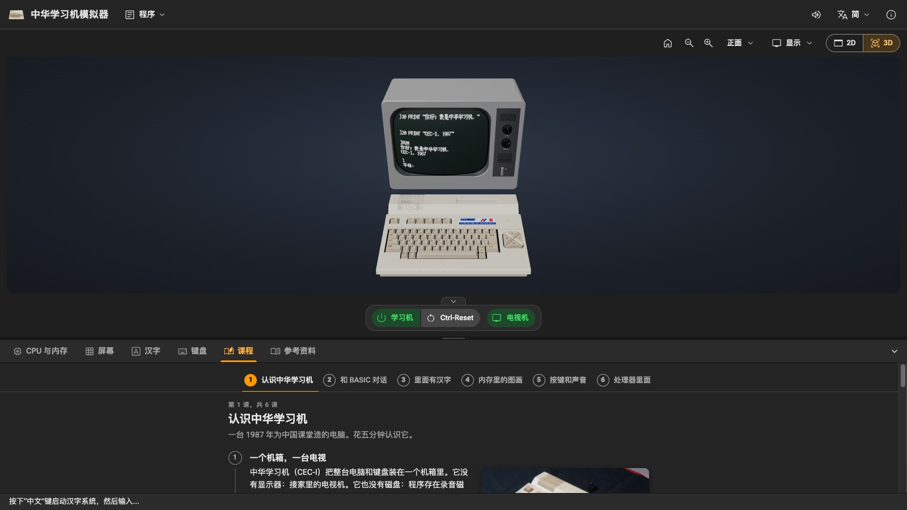

<p align="center"></p>

# 中华学习机模拟器 · CEC-I Simulator

[](https://github.com/wixette/cec-i-simulator/actions/workflows/test.yml)

**在浏览器里 3D 再现 1987 年的 CEC-I 中华学习机。** 开机、写 BASIC、输入汉字，再把它拆开，看看一台 8 位电脑怎样显示成千上万个汉字。

**[▶ 在线试用](https://wixette.github.io/cec-i-simulator/)**：无需安装，电脑和手机都可以用，简体中文和英文界面。

> **English:** The CEC-I 中华学习机 (China Educational Computer, 1987) was China's school computer: an Apple IIe compatible with the whole GB 2312 Chinese character set in two font chips on its main board. This simulator runs its own ROMs in your browser, in 3D, with its TV and its keyboard. **[Read the English README](README.en.md).**



> 这是预发布版（v0.0.3）。“程序”菜单里有我们自己写的十五个程序（游戏、汉字、音乐、LOGO 等），游戏杆可以用键盘操纵，机器下方的四个仪表演示它的工作原理。课程和录音机将在后续版本中加入（[路线图](design/roadmap.md)）。

## 中华学习机是什么？

1984 年，邓小平提出“计算机的普及要从娃娃做起”。清华大学主持的联合设计组为此设计了 **CEC-I 中华学习机**，1987 年推出：一台与 Apple IIe 兼容的电脑，主机和键盘做在一个机壳里，用家里的电视机当显示器，用录音机保存程序，售价约 960 元。在全国各地中小学的机房里，许多学生在它上面写下了自己的第一个程序。

它的特色是汉字。同时代的电脑只认得 96 个字母和符号；中华学习机却把国家标准字符集 GB 2312 的 7445 个字符，以 16 × 16 点阵装进主板上的两片字库芯片，按一下“中文”键就能进入汉字系统，不需要软盘。

本模拟器就是这样一台机器，一个零件一个零件地再现：

| | 中华学习机 | 模拟器 |
|---|---|---|
| 处理器 | 6502，约 1.02 MHz | 同样的 6502，每条指令的周期数都准确，通过全部 151 万个 SingleStepTests 测试 |
| ROM | 系统 ROM（监控程序、CEC-BASIC、LOGO）、汉字系统 ROM、两片字库、字符发生器、键盘 ROM | 一台能正常工作的学习机的全套 ROM（[roms/NOTICE](roms/NOTICE)） |
| 内存 | 64 KB（48 KB 加语言卡的 16 KB），没有辅助内存 | 相同 |
| 汉字 | GB 2312 全部 7445 个字符；拼音和区位输入 | 相同，运行它自己的汉字系统 |
| 显示 | 接电视机或监视器：40 × 24 文本、低分辨率和高分辨率彩色图形 | 一台八十年代的彩色电视机；也可以换成黑白电视机或绿色单色显示器 |
| 声音 | 内置喇叭，`MUSIC` 命令 | 相同 |
| 暂时没有 | 录音机、软盘驱动器、打印机 | |

## 开始的几分钟

1. **打开模拟器。** 学习机和电视机已经开机：屏幕上是 `ZHONG HUA XUE XI JI` 和 `VERSION 1.1`，然后是 BASIC 的提示符 `]`。
2. **输入** `PRINT "HELLO"`，按回车。学习机会回答。
3. **按“中文”键**（你键盘上的 Page Up，或 Alt-Z）：汉字系统启动。“西文”键（Page Down，或 Alt-X）返回。
4. **写汉字：** 点“程序 ▸ 输入文字”，粘贴一段带汉字的 BASIC 程序，再点“输入”。模拟器会用学习机自己的区位码输入法把它一个键一个键地打进去。
5. **玩一玩：** 点“程序 ▸ 游戏 ▸ 贪吃蛇”，再点“输入”。在机器下方的按钮条上插上游戏杆，就能用方向键操纵。
6. **拆开看看：** 关机，在 3D 视角菜单中选“拆开”。

**你的键盘就是学习机的键盘。** 字母、数字和符号都在原位；学习机特有的键：

| 学习机 | 你的键盘 | 或者 |
|---|---|---|
| 中文 | Page Up | Alt-Z |
| 西文 | Page Down | Alt-X |
| F1–F5 | F1–F5 | Alt-1 … Alt-5 |
| Quit | F6 | Alt-Q |
| Test | End | Alt-T |
| Reset | F12 | Alt-R |
| ◁ | Backspace | ← |

Ctrl-Reset 是 Ctrl-F12。在手机上请切换到 2D 视图，用屏幕上的键盘打字。

## 能做什么

- **3D 和 2D 两种视图：** 3D 里有正面、斜侧、键盘、屏幕、背面、内部和拆开七个视角；2D 里电视机画面大而清晰，键盘是一个可以拉出的抽屉。
- **运行学习机的软件：** 西文 BASIC、汉字系统（拼音、区位）、LOGO、监控程序和小汇编、开机自检（Ctrl-Reset-TEST）。
- **输入、打开、保存程序：** 粘贴的文字会被“打”进学习机，汉字通过区位码输入；BASIC 程序可以存成文本文件，汉字仍是汉字。
- **换一台显示器：** 彩色电视机、黑白电视机或绿色单色显示器；机壳可以是崭新的样子，也可以是如今泛黄的样子。

学习机的四本原始手册已整理成数字版，见 [cec-i-docs](https://github.com/wixette/cec-i-docs) 项目。

---

## 开发者

在本地运行（无需构建）：

```
git clone https://github.com/wixette/cec-i-simulator.git
cd cec-i-simulator
python3 -m http.server 8000
```

然后打开 <http://localhost:8000/>。检查（需要 Node.js 和 pnpm）：

```
pnpm install
pnpm check            # 单元测试、严格类型检查和引用检查（CI 运行的就是这些）
pnpm test:browser     # 在无头 Chrome 中测试页面本身
```

更多内容（英文）：[开发说明](docs/development.md)、[代码约定](docs/conventions.md)、[界面设计](docs/ui-design.md)、[设计决定](design/decisions.md)、[路线图](design/roadmap.md)、[3D 模型](model/README.md)、[学习机的工作原理和实测数据](research/README.md)、[参与贡献](CONTRIBUTING.md)、[隐私](docs/privacy.md)。

## 许可证

- 代码使用 [Apache License 2.0](LICENSE)。
- 3D 模型、文档、照片和研究笔记使用 [CC BY-SA 4.0](LICENSES/CC-BY-SA-4.0.txt)。
- `roms/` 中的 ROM 不属于本项目，版权归学习机的制造者所有，作为历史文物收录；[roms/NOTICE](roms/NOTICE) 说明了来源，权利人如有要求即予删除。
- 第三方材料保留各自的许可证：three.js（MIT）、字体（OFL 1.1）、图标（Apache-2.0），见 [docs/licensing.md](docs/licensing.md) 和 `REUSE.toml`。

本项目与中华学习机的设计者和制造者无关。

## 致谢

- [cec-i-docs](https://github.com/wixette/cec-i-docs)：中华学习机四本书的数字版，本模拟器的主要依据。
- MAME 的中华学习机驱动和 ROM，用于对照。
- Tom Harte 的 [SingleStepTests](https://github.com/SingleStepTests/65x02)，用于检验 6502。
- [three.js](https://threejs.org/)，以及思源黑体和思源宋体（Noto Sans SC、Noto Serif SC）。
- 界面沿用作者的 [TRS-80 模拟器](https://github.com/wixette/trs-80-simulator)。
